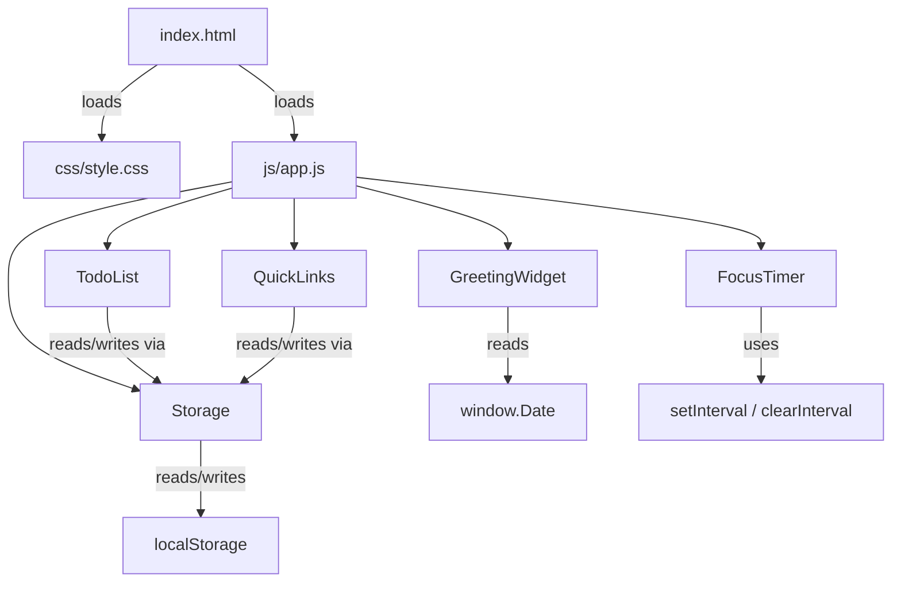
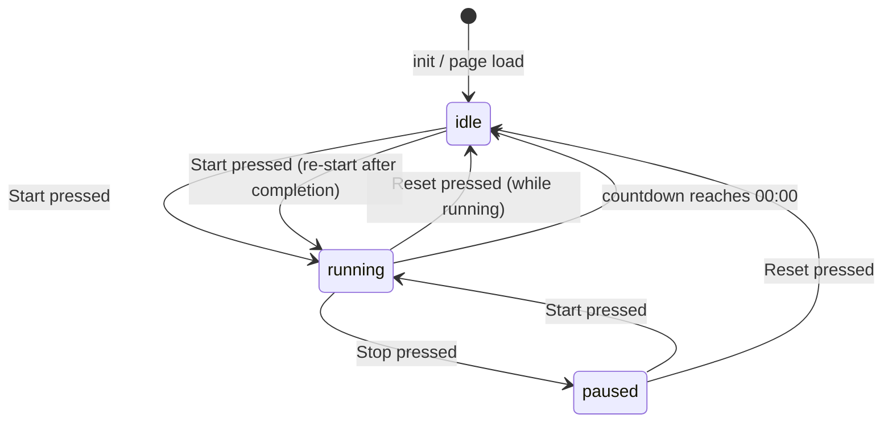

# Design Document

## Overview

The To-Do Life Dashboard is a client-side single-page web application composed of four independent
widgets: Greeting (time/date/greeting), Focus Timer (25-minute countdown), To-Do List (task
management), and Quick Links (URL launcher). It is implemented in pure HTML, CSS, and Vanilla
JavaScript with no build step, no external dependencies, and no network calls. All user data
persists through the browser's Local Storage API.

The project uses a strict single-file-per-type layout:

```
index.html          ← markup only; no inline styles or scripts
css/
  style.css         ← all styling
js/
  app.js            ← all JavaScript logic
```

The application must load and function correctly from both the `file://` protocol and any HTTP
server in Chrome, Firefox, Edge, and Safari (latest stable releases).

---

## Architecture

### High-Level Component Model



### Module Organization inside `app.js`

`app.js` uses a plain-object module pattern (no ES module `import`/`export` to maintain
`file://` compatibility across all browsers). Each widget is an immediately-invoked object
literal exposing an `init()` method and internal helpers. A top-level `DOMContentLoaded`
listener calls `init()` on each widget in order:

1. `Storage.init()` — no DOM dependency, runs first
2. `GreetingWidget.init()`
3. `FocusTimer.init()`
4. `TodoList.init()`
5. `QuickLinks.init()`

No widget depends on another widget's internal state; they communicate only through the
shared `Storage` object.

### File/Protocol Compatibility Notes

- ES module syntax (`import`/`export`) is intentionally avoided — Chromium and Safari block
  module scripts served over `file://` without a server header.
- `localStorage` is fully available under `file://` in all target browsers.
- `window.open(url, '_blank')` for Quick Links works under both protocols.
- No `fetch` or `XMLHttpRequest` calls appear anywhere in the codebase.

---

## Components and Interfaces

### Storage

A thin wrapper around `localStorage` that owns serialization and error handling.

```
Storage
  .TASK_KEY   = 'todo_tasks'       // const
  .LINK_KEY   = 'quick_links'      // const
  .save(key, data)                 // JSON.stringify → localStorage.setItem
  .load(key)                       // localStorage.getItem → JSON.parse; returns [] on null/error
```

`load()` behaviour:
- Returns `[]` when the key is absent (`null`).
- Returns `[]` and calls a registered `onError(key, rawValue)` callback when `JSON.parse` throws.
- The callback sets a visible error banner in the UI.

### GreetingWidget

Owns a single `setInterval` that fires every 1 000 ms and updates the DOM.

```
GreetingWidget
  .init()                // start interval, render immediately
  ._tick()               // read Date, format, update DOM
  ._formatTime(date)     // → "HH:MM"  (pure)
  ._formatDate(date)     // → "Weekday, DD Month YYYY"  (pure)
  ._getGreeting(hour)    // → greeting string  (pure)
  ._handleInvalidDate()  // show unavailability message
```

DOM bindings (IDs declared in `index.html`):

| Element ID         | Content             |
|--------------------|---------------------|
| `#greeting-time`   | HH:MM string        |
| `#greeting-date`   | Full date string    |
| `#greeting-text`   | Greeting phrase     |

Greeting rules (implemented as a lookup table over `hour`):

| Hour range (24-h)  | Greeting         |
|--------------------|-----------------|
| 05 – 11            | Good Morning     |
| 12 – 16            | Good Afternoon   |
| 17 – 20            | Good Evening     |
| 21 – 04 (next day) | Good Night       |

### FocusTimer

Manages a state machine with three states: `idle`, `running`, `paused`.

```
FocusTimer
  .TOTAL_SECONDS = 1500   // 25 × 60
  .state          // 'idle' | 'running' | 'paused'
  .remaining      // integer seconds left
  .intervalId     // setInterval handle or null

  .init()
  ._start()
  ._stop()
  ._reset()
  ._tick()        // decrement remaining; check for 0
  ._render()      // update DOM + control enabled/disabled states
  ._formatTime(seconds)  // → "MM:SS"  (pure)
```

State machine transitions:



DOM bindings:

| Element ID          | Purpose                     |
|---------------------|-----------------------------|
| `#timer-display`    | MM:SS countdown text        |
| `#timer-start`      | Start button                |
| `#timer-stop`       | Stop button                 |
| `#timer-reset`      | Reset button                |

Control enable/disable rules per state:

| State    | Start   | Stop    | Reset   |
|----------|---------|---------|---------|
| idle     | enabled | disabled| enabled |
| running  | disabled| enabled | enabled |
| paused   | enabled | disabled| enabled |

### TodoList

Manages an in-memory array of Task objects and re-renders the list on every mutation.

```
Task = {
  id:        string,   // crypto.randomUUID() or Date.now().toString()
  text:      string,   // 1–250 characters, trimmed
  completed: boolean,
  createdAt: number    // Date.now()
}
```

```
TodoList
  .tasks   // Task[]

  .init()
  ._add(text)
  ._toggle(id)
  ._startEdit(id)
  ._saveEdit(id, newText)
  ._delete(id)
  ._persist()       // calls Storage.save(TASK_KEY, tasks)
  ._render()        // full re-render of list
  ._renderItem(task) // → DOM element for one task
  ._validate(text)   // → boolean; trims and checks length 1–250
```

DOM bindings:

| Element ID          | Purpose                      |
|---------------------|------------------------------|
| `#todo-input`       | New task text field          |
| `#todo-add-btn`     | Add task button              |
| `#todo-list`        | `<ul>` list container        |

Each rendered task item contains:
- Checkbox input (`type="checkbox"`) for completion toggle
- `<span>` for task text (editable via `contenteditable` when in edit mode)
- Edit button
- Delete button

The input field has `maxlength="250"` as an HTML attribute to enforce the character cap in the
browser natively; the JS `_validate()` function also checks the length as a defensive
second layer.

Edit flow:
1. User clicks Edit → task text `<span>` becomes `contenteditable="true"`, edit button
   changes to Save, input is focused, text selected.
2. User presses Enter or clicks Save → `_saveEdit()` is called.
3. If the resulting trimmed text is empty, the original text is restored.
4. `contenteditable` is removed, button reverts to Edit, `_persist()` is called.

### QuickLinks

Manages an in-memory array of Link objects.

```
Link = {
  id:    string,
  label: string,   // 1–50 characters, trimmed
  url:   string    // must start with 'http://' or 'https://'
}
```

```
QuickLinks
  .links   // Link[]

  .init()
  ._add(label, url)
  ._delete(id)
  ._open(url)        // window.open(url, '_blank', 'noopener,noreferrer')
  ._persist()        // Storage.save(LINK_KEY, links)
  ._render()
  ._renderItem(link) // → DOM element for one link
  ._validateLabel(label)  // → boolean; trimmed length 1–50
  ._validateUrl(url)      // → boolean; starts with http:// or https://
  ._showError(field, msg) // display inline error adjacent to field
  ._clearErrors()
```

DOM bindings:

| Element ID          | Purpose                     |
|---------------------|-----------------------------|
| `#link-label`       | Label input field           |
| `#link-url`         | URL input field             |
| `#link-add-btn`     | Add link button             |
| `#link-list`        | Link buttons container      |
| `#link-label-error` | Inline error for label      |
| `#link-url-error`   | Inline error for URL        |

The label input carries `maxlength="50"` as an HTML attribute; `_validateLabel` trims and
re-checks as a defensive layer.

---

## Data Models

### Task (Local Storage, key: `todo_tasks`)

Serialized as a JSON array of objects:

```json
[
  {
    "id": "1700000000000",
    "text": "Review pull request",
    "completed": false,
    "createdAt": 1700000000000
  }
]
```

| Field       | Type    | Constraints                   |
|-------------|---------|-------------------------------|
| `id`        | string  | Unique; generated on creation |
| `text`      | string  | 1–250 chars after trim        |
| `completed` | boolean | Default `false`               |
| `createdAt` | number  | `Date.now()` at creation time |

### Link (Local Storage, key: `quick_links`)

Serialized as a JSON array of objects:

```json
[
  {
    "id": "1700000000001",
    "label": "GitHub",
    "url": "https://github.com"
  }
]
```

| Field   | Type   | Constraints                              |
|---------|--------|------------------------------------------|
| `id`    | string | Unique; generated on creation            |
| `label` | string | 1–50 chars after trim                    |
| `url`   | string | Must start with `http://` or `https://`  |

### Storage Schema

| Key           | Value type    | Writer          | Reader             |
|---------------|---------------|-----------------|--------------------|
| `todo_tasks`  | JSON string   | `TodoList`      | `TodoList.init()`  |
| `quick_links` | JSON string   | `QuickLinks`    | `QuickLinks.init()`|

---

## Correctness Properties

*A property is a characteristic or behavior that should hold true across all valid executions of a system — essentially, a formal statement about what the system should do. Properties serve as the bridge between human-readable specifications and machine-verifiable correctness guarantees.*

### Property 1: Time HH:MM format

*For any* valid `Date` object, `GreetingWidget._formatTime(date)` shall return a string matching
`/^\d{2}:\d{2}$/` where the first two digits equal the zero-padded 24-hour hour and the last two
digits equal the zero-padded minute of that Date.

**Validates: Requirements 1.1**

---

### Property 2: Date string contains all required components

*For any* valid `Date` object, `GreetingWidget._formatDate(date)` shall return a string that
contains a recognized English weekday name, a numeric day, a recognized English month name, and
the four-digit year corresponding to that Date.

**Validates: Requirements 1.3**

---

### Property 3: Greeting covers all hours without gaps or overlaps

*For any* integer hour in the range [0, 23], `GreetingWidget._getGreeting(hour)` shall return
exactly one of "Good Morning", "Good Afternoon", "Good Evening", or "Good Night" — specifically
"Good Morning" for hours in [5, 11], "Good Afternoon" for [12, 16], "Good Evening" for [17, 20],
and "Good Night" for all other hours (21–23 and 0–4).

**Validates: Requirements 1.4, 1.5, 1.6, 1.7**

---

### Property 4: Timer MM:SS format is a lossless encoding

*For any* integer `s` in [0, 1500], `FocusTimer._formatTime(s)` shall return a string matching
`/^\d{2}:\d{2}$/` and the string shall decode back to `s` via `minutes * 60 + seconds`.

**Validates: Requirements 2.7**

---

### Property 5: Adding a valid task grows the task list by exactly one

*For any* task list state and any non-empty, non-whitespace string of length ≤ 250 characters,
calling `TodoList._add(text)` shall increase the length of `TodoList.tasks` by exactly one and
the new item's `text` shall equal the trimmed input.

**Validates: Requirements 3.2**

---

### Property 6: Whitespace-only task submissions are rejected

*For any* string composed entirely of Unicode whitespace characters (including the empty string),
calling `TodoList._add(text)` shall leave `TodoList.tasks` unchanged.

**Validates: Requirements 3.3**

---

### Property 7: Every rendered task item contains all four required controls

*For any* Task object, `TodoList._renderItem(task)` shall return a DOM element that contains a
completion checkbox, the task text, an edit control, and a delete control.

**Validates: Requirements 3.4**

---

### Property 8: Completion toggle is a round-trip operation

*For any* Task in any completion state, calling `TodoList._toggle(id)` twice shall leave the
task's `completed` flag in its original state.

**Validates: Requirements 3.5, 3.6**

---

### Property 9: Whitespace-only edit is discarded and original text is preserved

*For any* Task with non-empty text and any whitespace-only edit string, calling
`TodoList._saveEdit(id, whitespaceString)` shall leave the task's `text` field unchanged.

**Validates: Requirements 3.8**

---

### Property 10: Deleting a task removes exactly that task from the list

*For any* task list and any valid task ID in that list, calling `TodoList._delete(id)` shall
decrease `TodoList.tasks.length` by exactly one and no task with that ID shall remain in the
list.

**Validates: Requirements 3.9**

---

### Property 11: Task list persistence is a round-trip

*For any* state of `TodoList.tasks` after any mutation (add, toggle, edit, delete), the value
returned by `JSON.parse(localStorage.getItem('todo_tasks'))` shall deep-equal `TodoList.tasks`.

**Validates: Requirements 3.10, 5.1, 5.3**

---

### Property 12: Link button label is capped at 50 characters

*For any* Link whose label has arbitrary length, `QuickLinks._renderItem(link)` shall produce a
button whose visible text is at most 50 characters long.

**Validates: Requirements 4.2**

---

### Property 13: URL validation rejects all non-http/https URLs

*For any* string that does not begin with `'http://'` or `'https://'`,
`QuickLinks._validateUrl(url)` shall return `false` and no Link shall be added to
`QuickLinks.links`.

**Validates: Requirements 4.4**

---

### Property 14: Deleting a link removes exactly that link from the list

*For any* link list and any valid link ID in that list, calling `QuickLinks._delete(id)` shall
decrease `QuickLinks.links.length` by exactly one and no link with that ID shall remain in the
list.

**Validates: Requirements 4.6**

---

### Property 15: Link list persistence is a round-trip

*For any* state of `QuickLinks.links` after any mutation (add, delete), the value returned by
`JSON.parse(localStorage.getItem('quick_links'))` shall deep-equal `QuickLinks.links`.

**Validates: Requirements 4.7, 5.2, 5.3**

---

## Error Handling

### Invalid Date API (Requirement 1.9)

If `new Date()` returns an object where `isNaN(date.getTime())` is `true`,
`GreetingWidget._tick()` calls `_handleInvalidDate()`, which:
- Sets `#greeting-time` text to "Time unavailable"
- Clears `#greeting-date` and `#greeting-text`
- Stops the interval to avoid repeated error DOM writes

### Corrupted Local Storage (Requirements 5.5, 5.6)

`Storage.load(key)` wraps `JSON.parse` in a `try/catch`:

```
try {
  const raw = localStorage.getItem(key);
  if (raw === null) return [];
  return JSON.parse(raw);
} catch (e) {
  onError(key, raw);   // display error banner
  return [];
}
```

The error banner is a fixed-position or top-of-page element with an ID of `#storage-error`
that is hidden by default and shown when this callback fires.

### Form Validation Errors (Requirements 3.3, 3.8, 4.3, 4.4)

Each validation failure is communicated without alerting or throwing:
- **To-Do input empty/whitespace**: the input field retains focus; no error text is needed
  beyond the absence of action (the UI does not change).
- **Quick Links label/URL empty**: `_showError(field, message)` populates the respective
  `#link-label-error` or `#link-url-error` element and sets `aria-invalid="true"` on the
  field.
- **Quick Links bad URL scheme**: same as above for the URL field.
- Errors are cleared (`_clearErrors()`) on the next successful submission or when the user
  starts typing in the offending field.

### Task Edit Cancel

If the user presses Escape while editing a task, the edit is cancelled and the original text
is restored (same behavior as saving empty text, except no DOM flash).

---

## Testing Strategy

### Dual Testing Approach

Unit tests cover specific examples, edge cases, and error conditions. Property-based tests
verify universal properties across a wide input space. Both are needed for comprehensive
coverage.

**Property-based testing library**: [fast-check](https://fast-check.dev/) (JavaScript, runs
in Node.js — no browser required for the pure-function and logic tests).

### Unit Tests (example-based)

Each widget's init, state transitions, and DOM interactions are covered by example tests:

- **GreetingWidget**: invalid Date fallback; DOM elements populated after `_tick()`.
- **FocusTimer**: initial state is `idle` / `25:00`; Start → running; Stop → paused; Reset
  → idle; countdown-to-zero disables Stop and enables Start/Reset; re-start after zero resets
  to 25:00.
- **TodoList**: add + clear input; edit saves new text; edit with empty string restores
  original; delete removes item; load from pre-populated localStorage.
- **QuickLinks**: empty label shows error; empty URL shows error; invalid scheme shows error;
  valid submission adds button; delete removes button; load from pre-populated localStorage;
  empty storage renders empty state.
- **Storage**: null key returns `[]`; malformed JSON returns `[]` and fires error callback;
  save writes correct key with JSON string.

### Property-Based Tests (fast-check, minimum 100 iterations each)

Each test references its design property in a leading comment using the tag format:
**Feature: todo-life-dashboard, Property N: \<property text\>**

| Test | Property | fast-check arbitraries |
|------|----------|------------------------|
| formatTime produces valid HH:MM | P1 | `fc.date()` |
| formatDate contains all date components | P2 | `fc.date()` |
| getGreeting covers all 24 hours | P3 | `fc.integer({min:0, max:23})` |
| formatTimerSeconds round-trips | P4 | `fc.integer({min:0, max:1500})` |
| add valid task grows list by 1 | P5 | `fc.string({minLength:1, maxLength:250}).filter(s => s.trim().length > 0)` |
| whitespace-only text rejected | P6 | `fc.string().map(s => s.replace(/\S/g, ' '))` |
| renderItem contains all controls | P7 | `fc.record({id: fc.string(), text: fc.string(), completed: fc.boolean(), createdAt: fc.integer()})` |
| double-toggle preserves completed | P8 | `fc.boolean()` for initial state |
| whitespace edit discards | P9 | `fc.string().filter(s => s.trim() === '')` |
| delete removes exactly one task | P10 | `fc.array(taskArbitrary, {minLength:1})` + random index |
| task persistence round-trips | P11 | `fc.array(taskArbitrary)` |
| link label capped at 50 | P12 | `fc.string()` for label |
| invalid URL scheme rejected | P13 | `fc.string().filter(s => !/^https?:\/\//.test(s))` |
| delete removes exactly one link | P14 | `fc.array(linkArbitrary, {minLength:1})` + random index |
| link persistence round-trips | P15 | `fc.array(linkArbitrary)` |

### Integration / Smoke Tests

- File structure audit: exactly one CSS file in `css/`, exactly one JS file in `js/`, no
  `<style>` blocks, no inline `style` attributes, no inline `<script>` logic.
- Storage key names: after any task write the key is `'todo_tasks'`; after any link write
  the key is `'quick_links'`.
- No `fetch` / `XMLHttpRequest` calls present in `app.js` (static grep).
- Smoke test: open `index.html` via `file://` in each target browser; all four widgets render
  and respond to basic interactions.
